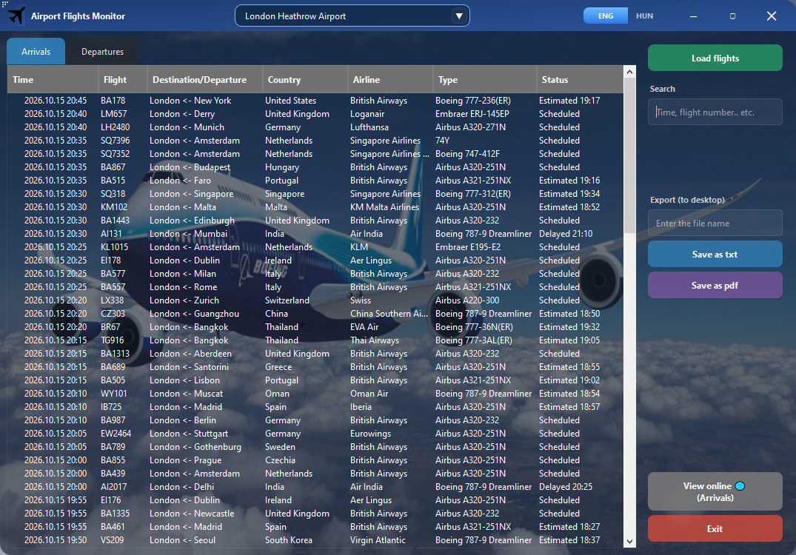
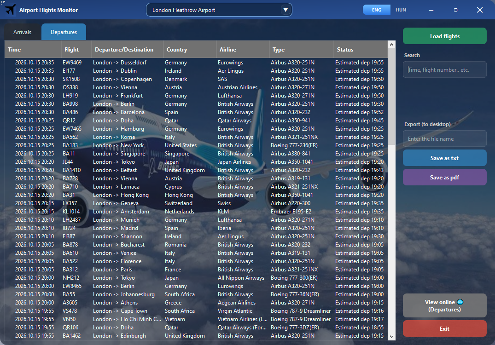
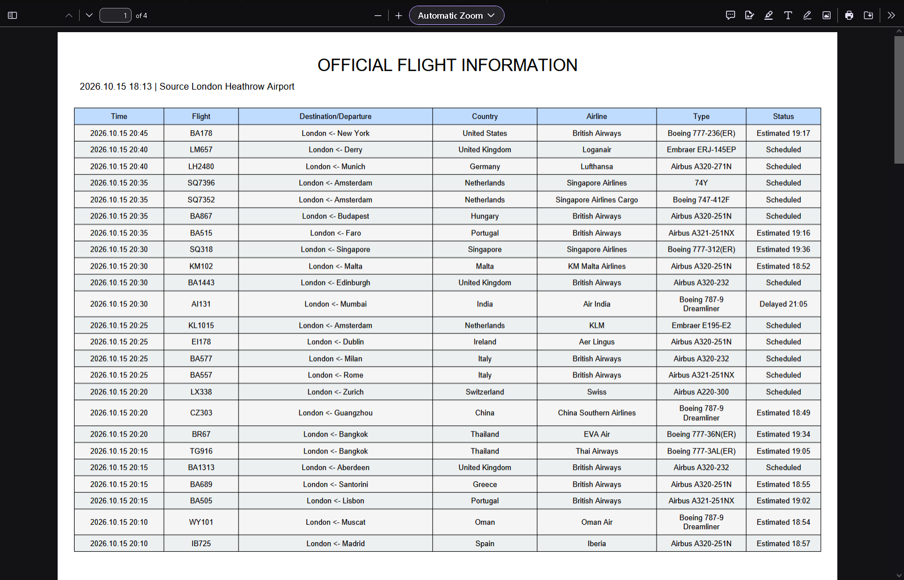
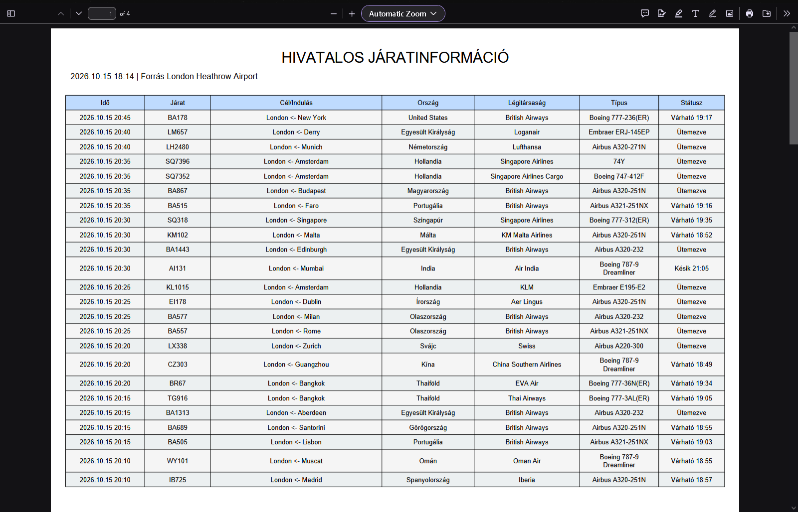
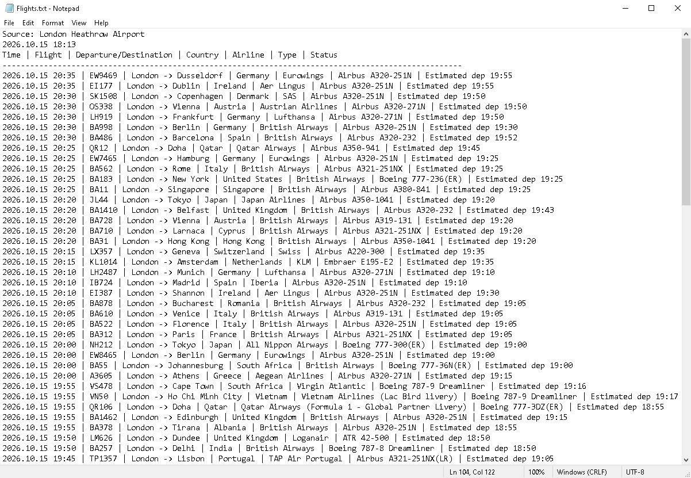
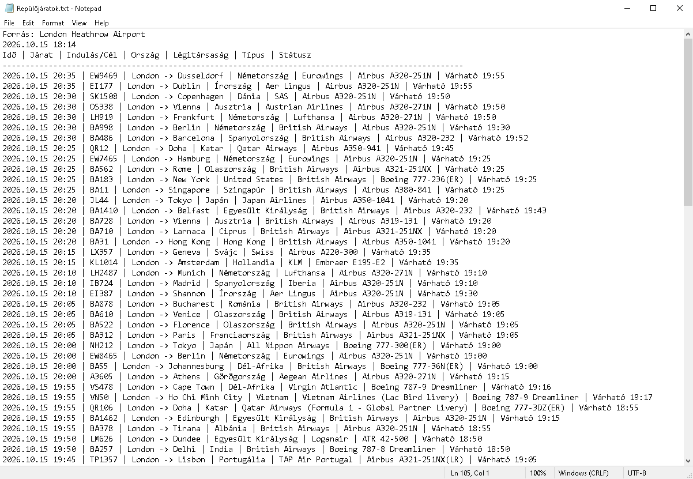

# Airport Flights

A modern PySide6 desktop application for viewing airport arrivals and departures.

## Overview

Airport Flights allows you to select from 9,000 airports worldwide and view their current arrival and departure information. Flight data can be searched, copied, and exported to PDF or TXT files with a single click. Exports include the data from the currently active tab (arrivals or departures) in the selected format.

The application features a custom graphical interface, with instant switching between English and Hungarian.

## Features

- **9,000 Airports** - Search and select an airport from the available list.
- **Arrivals and Departures** - View flight information in separate tabs.
- **Search** - Quickly filter the displayed flights.
- **Copy Data** - Right-click any displayed information and select **Copy**.
- **PDF and TXT Export** - Save flights from the current tab in either format to the desktop.
- **English and Hungarian** - Instant switch between languages without restarting the application.
- **Localized Exports** - PDF and TXT files are exported in the currently selected language.

## Demo

**Short application walkthrough showing airport selection and loading, arrivals/departures, search, language switching, and PDF/TXT export in English and Hungarian.**
<p align="center">
  
</p>

## Screenshots

**Application GUI - Arrivals and Departures (English)**
<p align="center">
  
  
</p>

**PDF Export - English and Hungarian**
<p align="center">
  
  
</p>

**TXT Export - English and Hungarian**
<p align="center">
  
  
</p>

## Built With

- Python 3.14
- PySide6 - Cross-platform GUI framework
- FlightRadarAPI - an unofficial Python wrapper for accessing Flightradar24 flight data
- ReportLab - PDF generation

## Installation

Clone the repository:
```bash
git clone https://github.com/rolandmorgan-dev/airport-flights.git
cd airport-flights
```

Install the required dependencies:
```bash
pip install -r requirements.txt
```

## Usage

Run the application from source:
```bash
python flights.pyw
```

## Project Structure

```text
airport-flights/
├── images/              # Application images
├── screenshots/         # Preview screenshots
├── src/                 # JSON configuration files
├── .gitignore
├── LICENSE
├── README.md
├── demo.gif             # Application walkthrough
├── flights.pyw          # Application entry point
└── requirements.txt     # Python dependencies
```


# Disclaimer

*This project is for educational and portfolio purposes only. It uses an unofficial Python API wrapper to fetch flight data. Flightradar24 AB is the service provider. This project is not affiliated with, endorsed by, or sponsored by Flightradar24.*
